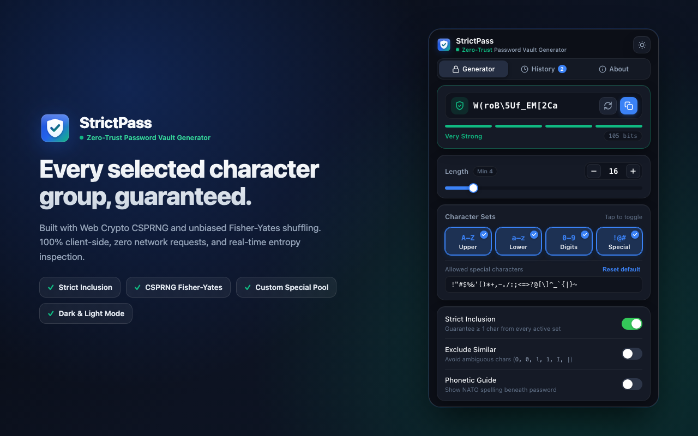
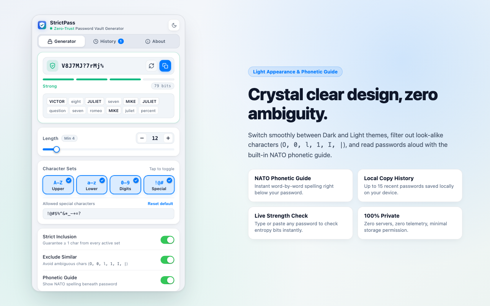

<div align="center">
  
  <h1>StrictPass — Zero-Trust Password Vault Generator</h1>
  <p>
    <strong>Passwords that strictly obey every rule.</strong><br />
    A minimalist, privacy-first Chrome Extension (Manifest V3) powered by Web Crypto CSPRNG and Fisher-Yates shuffling — 100% client-side.
  </p>
  <p>
    <a href="https://tuyennq1001.github.io/strictpass/"><strong>Website &amp; Live Demo</strong></a>
    &nbsp;&bull;&nbsp;
    <a href="https://tuyennq1001.github.io/strictpass/#privacy"><strong>Privacy Policy</strong></a>
    &nbsp;&bull;&nbsp;
    <a href="#preview"><strong>Screenshots</strong></a>
    &nbsp;&bull;&nbsp;
    <a href="#installation"><strong>Installation</strong></a>
  </p>
</div>

---

## Overview

**StrictPass** is engineered so no selected character group is ever skipped. Unlike random generators that can omit enabled categories—especially on shorter passwords—StrictPass mathematically guarantees at least one character from every active category before shuffling the full password with an unbiased CSPRNG Fisher-Yates pass.

- **Website & Live Interactive Demo:** https://tuyennq1001.github.io/strictpass/
- **Manifest Version:** Chrome Extension Manifest V3 (`v1.0.0`)
- **Architecture:** 100% Client-Side &bull; Zero Network Requests &bull; Zero Telemetry

---

## Features

- **Strict Inclusion Guarantee:** Every active category (`A–Z` Uppercase, `a–z` Lowercase, `0–9` Digits, `!@#` Special) is guaranteed at least one character before shuffling. Minimum length clamps dynamically to the number of active groups.
- **Unbiased Web Crypto CSPRNG:** Uses `crypto.getRandomValues` with rejection sampling to eliminate modulo bias, followed by an unbiased Fisher-Yates shuffle.
- **Real-Time Strength Meter:** Type or paste any custom password directly into the hero box to inspect entropy bits and strength rating (`Weak` → `Very Strong`) immediately.
- **Editable Special Pool:** Customize exact allowed symbols per website policy with one-click reset, plus optional exclusion of visually ambiguous characters (`O, 0, l, 1, I, |`).
- **NATO Phonetic Guide:** Toggle a clear phonetic spelling breakdown beneath your password so reading characters aloud or transcribing is effortless.
- **Local-Only Copy History:** Optionally store up to 15 recently copied passwords locally via `chrome.storage.local` with one-click copy and instant clear.
- **Dark & Light Appearance:** Apple-inspired interface with instant Dark and Light theme switching and a 3-tab segmented control (`Generator` | `History` | `About`).

---

## Preview

| Dark Mode | Light Mode &amp; Phonetic Guide |
| :---: | :---: |
|  |  |

---

## Privacy Policy

StrictPass is built with a strict privacy-first architecture. All password generation, strength evaluation, and preference storage happen exclusively inside your local browser.

- **No Data Collection:** StrictPass does not collect, store, transmit, share, or sell any personal data, browsing history, generated passwords, or analytics.
- **Minimal Permission (`storage` only):** Uses `chrome.storage.local` solely to persist local preferences (length, character groups, theme) and optional local-only copy history on your device.
- **Zero External Requests:** No external servers, no remote code execution, and no third-party tracking cookies are ever used.

Full policy: https://tuyennq1001.github.io/strictpass/#privacy

---

## Installation (Developer Mode)

1. Clone this repository:
   ```bash
   git clone https://github.com/tuyennq1001/strictpass.git
   ```
2. Open Google Chrome and navigate to `chrome://extensions/`.
3. Enable **Developer mode** in the top-right corner.
4. Click **Load unpacked** (or **Reload** if updating) and select the cloned `strictpass` folder.

---

## Running Tests

Unit tests verify strict character-group inclusion, custom special character pools, length clamping, disambiguation filtering, strength/entropy scoring, and NATO phonetic generation:

```bash
npm test
```

---

## Author

**Terry Nguyen** — Creator & Maintainer  
GitHub: [tuyennq1001/strictpass](https://github.com/tuyennq1001/strictpass) &bull; Website: [tuyennq1001.github.io/strictpass](https://tuyennq1001.github.io/strictpass/)

*Designed for speed, clarity, and security.*
